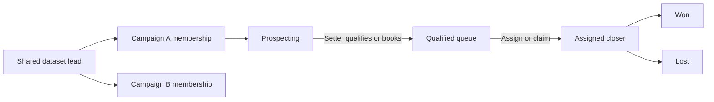

# Campaign roles, handoff and performance

The unit of work is a campaign membership: `(workspace_id, campaign_id, lead_id)`. The dataset keeps shared contact details. Qualification, appointments, closer ownership, outcomes and performance belong to the campaign membership. Adding the same lead to another campaign creates a separate journey.

## Access and work roles

Access roles remain Owner, Manager, Member and Viewer. A work role belongs to an existing campaign assignment and does not grant more access:

| Work role | Responsibility |
| --- | --- |
| Appointment setter | Outreach, qualification and appointment booking; handoff of their qualified leads |
| Closer | Claim or receive qualified leads; record closing outcomes |
| Full cycle | Both responsibilities |

The workspace owner and that campaign's managers can assign work roles to existing teammates. The same teammate can be a setter in one campaign and a closer in another. Viewers remain read only. Existing working assignments default to Full cycle to preserve their current capabilities. Owners and managers retain administrative oversight.

Campaign team controls are on the campaign page. Workspace invitations/access remain under Team & access. Work roles can be assigned after an invitation is accepted.

## Lead handoff

- Mark qualified or log Meeting Booked: the lead immediately appears under Qualified in that campaign. Meeting booking does not depend on accepting a suggested status.
- The setter/manager can choose a valid closer, or leave the lead available for a closer to claim.
- A closer cannot take an already-assigned lead from another closer. A stale action fails with a refresh message.
- Pending meeting reminders follow a closer assignment. Newly created meeting reminders use the appointment's local date and go to the current closer. Completed task credit never changes during a handoff.
- A closer records Won/Lost on a qualified lead. Owners/managers can reopen a lead for prospecting. Existing administrative status controls remain available.
- Removing closing access releases the closer assignment. It does not erase qualification or closing history.

## Data and authorization

`campaign_access.work_role` stores the campaign-specific responsibility. `campaign_leads` stores the current workflow stage, qualification, appointment time, closer, closing attribution and an optimistic version.

`orms_campaign_lead_action` is a transaction: it validates workspace membership, access/work role, lead membership, closer eligibility and version; saves progress and timeline; and returns the saved row. Each intent carries a UUID and payload hash. Retrying the same request after a lost response returns its original result instead of repeating the action. Reusing a request UUID with different input fails.

Database triggers also cover existing status controls and meeting quick-log entries. Protected metadata cannot be written through ordinary client updates. Public RPCs independently validate their scope. No service key is shipped to the client.

`campaign_work_events` is a server-written, immutable milestone ledger. Actor identity, display name and work role are captured when work happens. Stable actor/lead references retain aggregate history if an account/contact is later deleted. Campaign/workspace foreign keys enforce isolation. First milestone uniqueness applies per campaign and lead, including re-added memberships.

## Reporting definitions

Owner reports cover one campaign or all campaigns in the active workspace. Campaign managers can report only on campaigns they manage. Workers cannot invoke team-wide performance reporting.

| Metric | Definition |
| --- | --- |
| Touches/replies | Logged activity events by the actual actor, within the selected period |
| Qualified | First recorded qualification of each lead in each campaign |
| Appointments set | First recorded appointment booking per campaign lead; reschedules do not add another booked lead |
| Wins/losses | First recorded closing outcome of each kind per campaign lead |
| Not a fit | First prospecting rejection, separate from a closer's qualified-lead loss |
| Tasks completed | Actual completing member and completion timestamp, not the task creator |
| Pending/overdue | Current assignments, with overdue dates evaluated in the report timezone |
| Qualified queue/current pipeline | Current state, separate from historical achievement counts |

Reopening does not erase first-achievement credit or create another first milestone. Consequently historical wins and current pipeline wins can differ. Role labels in the member table show the current assignment; the ledger preserves the role at action time. Previous lead statuses are backfilled into the current pipeline without inventing qualification dates or individual credit. Reporting begins crediting workflow milestones when this migration is enabled.

PostgreSQL aggregates member, campaign and collective totals before API pagination. Outreach charts read all pages as well. Across campaigns, the owner sees both member totals and the per-campaign breakdown. CSV export includes the selected member's breakdown and neutralizes spreadsheet formula prefixes.

## Local review and validation

Run `npm run preview:workflow` for a loopback-only preview backed by embedded PostgreSQL. It prints the campaign URL. Use `owner@preview.orms`, `setter@preview.orms`, `closer@preview.orms`, `manager@preview.orms` or `viewer@preview.orms` with `PreviewOnly!123`. The preview covers campaign workflows using synthetic data; it resets when stopped and cannot send invitation emails or access live Supabase/Google credentials. Normal development/build output stays separate.

`npm test` runs existing tests plus PostgreSQL RLS/trigger/transaction tests and workflow client tests. Tests cover independent campaigns, actor credit, bookings, duplicate requests, rescheduling, claim conflicts, permission bypass attempts, reminder ownership, role removal, deleted-account history, legacy data, report scope and more than 1,000 activity rows. Also run `npm run lint` and `npm run build`.

The deployment migrations are `20261102000002_campaign_workflow.sql` and `20261102000003_campaign_reporting.sql`, in that order after the existing migrations. Code handles an older database by keeping its current campaign UI available until the update is enabled. Neither migration is applied to the live project by the preview or tests. Publishing and applying live changes are separate deployment steps requiring the owner's go-ahead.
